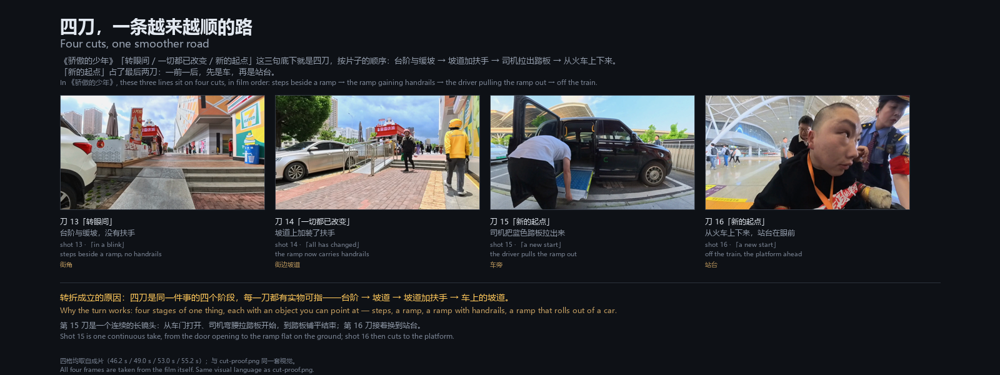
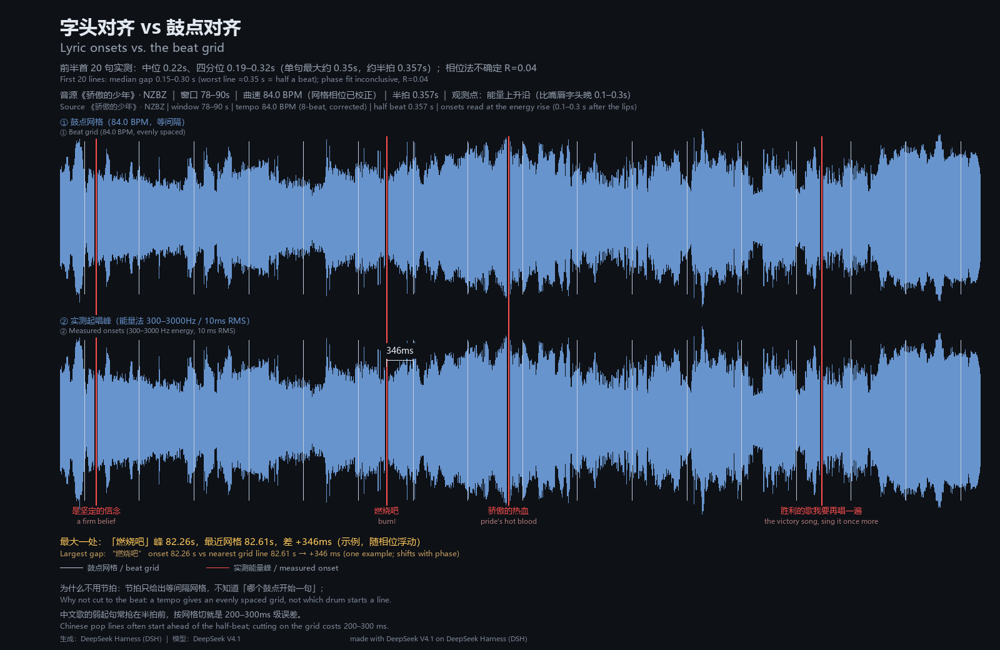
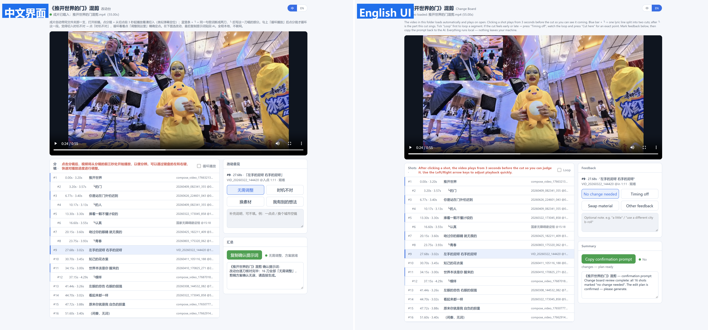

# 歌词字头混剪 · Lyric-Onset Montage

[English](./README.md)

**切点贴唱出来的字，不贴鼓点，也不贴字幕。**

给 AI agent 用的技能：一首歌加一个素材目录，剪成一版每一刀都落在歌词首字上的混剪。字头从音频里量，选画面和定切点分开判，交付的时候给的是可以自己核对的图和数据，不是一句「看着挺贴」。

## 安装

```bash
npx skills add qjzzsky/lyric-onset-montage
```

这条路在本仓库实测过：skills.sh 克隆仓库、认出 1 个技能，按它检测到的 agent（Claude Code / Codex / Cursor / Amp / Cline 等）装好 `lyric-onset-montage`。

用 GitHub CLI 的话，要指明装给哪个 agent：

```bash
gh skill install qjzzsky/lyric-onset-montage lyric-onset-montage --agent codex
```

Hermes 不在上面那份 agent 名单里，改用复制目录：把仓库里的 `skills/lyric-onset-montage/` 整个拷到本机技能目录，再 `hermes skills list` 看有没有 `lyric-onset-montage`。

---

## 素材先看懂，再分类



选材不是翻文件名猜内容。剪之前先把素材当资料读一遍：

- **抽帧看画面。** 一秒一帧或拼成网格，看这一条里到底有什么：空镜、人群、正脸、牌面、可读的电话号码。
- **抽音轨转写。** 判断里面是讲话还是歌词。讲话只用来判断「这段在讲什么」，不参与卡点；歌词才用来判句界、量字头。
- **打标签。** 每条素材标上 `★ 黄金窗口`、`● 可用`、`⛔ 不可用`，弃用的也照写。
- **一条素材切几个窗口。** 别把一个文件当一整块：按内容分成几段，各记各的时间区间和可用性，同一个文件里往往能出好几刀。
- **写进索引。** 弃用的镜头也写进去并标 `⛔`，下一首歌就不会再挑到；同一个索引反复用，第二首起就不用重新盘点。

索引的精细度按素材量自适应：素材只有几条、每条十几秒，直接精查；几十条或总时长两小时以上，先粗查一遍再问要不要精查，并给出预估时间。

分对了，一句歌词才拆得开。上面这张图就是「转眼间 / 一切都已改变 / 新的起点」这三句底下的四刀：台阶与缓坡 → 坡道加了扶手 → 司机拉出蓝色踏板 → 从火车上下来。

具体到上面这个案例，第二格比第一格多出来的那道扶手，就是「一切都已改变」最直白的画面——不是抽象的变好，是多了可以扶的东西。

「新的起点」占了最后两刀：第 15 刀是一个连续的长镜头，从车门打开、司机弯腰拉踏板开始，到踏板铺平结束；第 16 刀接着换到站台。所以候选表每段摆 3–4 个首选 + 3–6 个备选，附上这么选的理由，由你点头再下刀。

---

## 再看刀口：节拍网格 vs 实测字头



上轨是节拍网格，下轨是实测字头，红线是真实的切点。

这一版 115 秒的成片里，鼓点和字头差 **中位 222 毫秒、最大 346 毫秒**（n=20），差不多半拍——按鼓点切是听得出来的错；按字幕时间切偏差小一些，但也听得出来。

> **数字怎么读：** `A` = 切点 − 实测字头，回答「这一刀准不准」。`B` = 最近鼓点 − 实测字头，回答「要是按鼓点切会差多少」。`B` 是独立对照；`A` 用的是同一族检测器量的，数字小只能说明「自洽」，说明不了「对」。真正独立的验收是耳朵——下面每个案例都是人听完点头或打回的，改动都留了档。

三类证据图各自怎么读、怎么出：见 [`showcase/证据图例.md`](showcase/证据图例.md)。

---

## 三件踩点剪辑做不到的事

1. **切点落在唱出来的字头上，从音频里量。** 字幕和 LRC 只用来缩窗，因为它们普遍比歌声早 **0.1–0.27 秒**；拿字幕时间下刀，就是每一刀都早。
2. **切点和选画面分开判。** 片子可以帧级精确却全是空镜，也可以画面都对但每句早 200 毫秒。两个指标、两次检查，不合成一个分数。
3. **时间和选材各看一张图。** 一张答「这一刀准不准」，一张答「这几格选得对不对」，两件事不能互相替代。

---

## 四份案例，见证项目的成长

每一份是技能的一个阶段：它当时能做到什么，以及它当时还错在哪。第三列是那一版跑在什么环境里，方便对照。

| # | 案例                                     | 环境                               | 路线                                                  | 证明什么                                           |
| - | -------------------------------------- | -------------------------------- | --------------------------------------------------- | ---------------------------------------------- |
| ① | [`意外-20261018`](showcase/意外-20261018/) | Hermes Agent · 小米 MiMo V2.6 系列   | 没有歌词来源：先按句切，再改成贴字头                                  | **开始的地方**。从「按句切」到「贴字头」，按拍切会差 160–369 毫秒        |
| ② | [`骄傲的少年-115s`](showcase/骄傲的少年-115s/)   | DeepSeek Harness · DeepSeek V4.1 | 专辑版 LRC ↔ 音轨互相关解偏移（**+1.83 秒**），20 句复核中位 **0.10 秒** | **把时间基准解出来了**，A/B 从这时候分成两个指标                   |
| ③ | [`推开世界的门-55s`](showcase/推开世界的门-55s/)   | Hermes Agent · DeepSeek V4.1     | 副歌切片 55 秒、16 刀，交付后又改了 **六轮、9 处实改**                    | **改片是一等步骤**。唯一一份完整的「交付后怎么改」实录，包括那次按图注号改错了 4 刀  |
| ④ | [`快乐小神仙-176s`](showcase/快乐小神仙-176s/)   | Hermes Agent · DeepSeek V4.1     | 没有字幕轨：靠画面烧录字幕检出 37 段句界                              | **最难的一种**。47 刀、176.00 秒、0 返修；也是唯一明写「指标不能自证」的一份 |

规格、逐刀明细、自检报告都在各自目录里。

曲目署名：《意外》薛之谦（词曲 杨子朴）｜《骄傲的少年》南征北战NZBZ（词 赵辰龙 / 曲 汀洋）｜《推开世界的门》杨乃文（词曲 火星电台 / 黄少峰）｜《快乐小神仙》天唱组合（词 张藜 / 曲 肖白）。词曲与录音的权利归各权利人，这四个案例只做技术复盘。素材在案例里一律用代号 `S01`…，原文件名不公开。

---

## 安装

技能就是一个目录，agent 直接读；没有常驻服务，不需要 API key。

```text
# Hermes Agent
把 skills/lyric-onset-montage/ 放到  <hermes 配置目录>/skills/media/

# Claude Code 及兼容的 agent
cp -r skills/lyric-onset-montage  ~/.claude/skills/

# 其他
让 agent 读 skills/lyric-onset-montage/SKILL.md，reference 目录一起读
```

agent 要的东西全在 `skills/lyric-onset-montage/` 里面：`SKILL.md`、`references/`、`scripts/`、`templates/`。README 是给人的，技能是给 agent 的。

---

## 运行环境要求

|             | 最低                              | 推荐                                     | 为什么                                    |
| ----------- | ------------------------------- | -------------------------------------- | -------------------------------------- |
| **模型：读图**   | 必须                              | 全模态                                    | 首帧拼图、候选抽帧、烧录字幕条，都得靠看                   |
| **模型：上下文**  | ≥64k                            | ≥200k                                  | 一版 47 刀的表 + 27 步流程 + `references/`     |
| **工具：命令执行** | 必须                              | 必须                                     | ffmpeg、ffprobe、几个 Python 脚本            |
| **工具：文件读写** | 必须                              | 必须                                     | 读素材目录，写切片和表格                           |
| **工具：后台任务** | 有更好                             | 必须                                     | 编码要几十分钟，还得能报进度                         |
| **运行时**     | ffmpeg + ffprobe + Python 3.10+ | 再加 numpy / scipy / matplotlib（工程 venv） | `check_cut.py` 出 A/B 和首帧拼图             |
| **素材**      | 自己拍的视频                          | 有素材索引更好                                | 有索引就不用每首歌重新盘点                          |
| **网络**      | 未测试                             | 未测试                                    | 作者的运行环境一直在联网状态，断网能不能跑完没有验证过；技能本身不联网取素材 |
| **下载器**     | 不需要                             | 不需要                                    | 本技能不附带任何下载器                            |

**已在三种组合上实测出片**（作者自己的运行记录，下面每一行都出过成片）：

| 载体                          | 模型              | 结果 |
| --------------------------- | --------------- | -- |
| Hermes Agent（Nous Research） | 小米 MiMo V2.6 系列 | ✅  |
| Hermes Agent                | DeepSeek V4.1   | ✅  |
| DeepSeek Harness（DSH）       | DeepSeek V4.1   | ✅  |

同系列里有大小不同的档位，按任务选；技能在各档上都能跑，所以这张表只写版本号。

---

## 三行就能开工

```text
用 <音乐文件或媒体流路径> 这首歌，帮我剪一个贴合歌词的混剪视频。
素材在 <素材目录路径>，按这个目录里的内容去分析，然后剪出成片。
范围：<整首 / 到第一遍副歌 / 某句为止>
```

这就是全部交代。剩下的——盘素材、找歌词、量字头、排分镜——是技能的事。

---

## 工作流：27 步，5 段

每一步「失败长什么样」在 [`references/workflow.md`](skills/lyric-onset-montage/references/workflow.md)。

| 段         | 步                                              | 产出                  | 常见的失败                       |
| --------- | ---------------------------------------------- | ------------------- | --------------------------- |
| **A 立项**  | 1–5 开工提示词 · 范围与结尾点 · 取音频 · 素材盘点 · 环境体检         | 范围、48k 音频、`素材清单.md` | 用「十几秒一帧」粗查，然后照着它写窗口         |
| **B 时间轴** | 6–12 歌词来源 · 句界 · 字头 · 辅助校验 · 时间基准 · 字头表 · 三角互证 | 带置信度的 `字头表.csv`     | 把字幕时间当字头                    |
| **C 选材**  | 13–17 挑候选 · 抽帧复核 · 语境核对 · 预览 · 用户点头            | 每段 3–4 首选 + 3–6 备选  | 每段只给一个方案，一句不对整片重排           |
| **D 出片**  | 18–22 分镜表 · 逐刀验算 · 切镜头 · 拼接合曲 · 体检             | 无缝时间轴、单轨音频          | `-c copy` 丢帧、`-shortest` 截尾 |
| **E 交付**  | 23–27 交付 · 收改动 · 最小改动 · 改动台账 · 回写索引            | 成片、分镜首帧、镜头表、自检报告、改动台 | 为了一刀重做整片                    |

E 段还多给一件东西：按镜头表生成的**改动台**，能在浏览器里一刀一刀过、直接指到那一帧，不用心算秒数——见下面「在浏览器里精准校对」。

---

## 用一句话改

交付不是终点。说清是哪一刀、哪里不对：

```text
<某一句歌词> 这一段的镜头跟歌词不太搭，帮我换掉。
<某一分镜> 切早了，往后挪一点。
<某一分镜> 画面还没看清就过去了，留一个。
```

三种说法覆盖绝大多数改动：换素材、挪切点、一条素材内部挑一个瞬间。只重切被点名的那几刀，其余切片直接复用，交付里附「其余没动」的证据。

---

## 在浏览器里精准校对



`templates/build_changeboard.py` 读镜头表，在成片同一个目录里生成 `改动台.html`。一个文件，不用服务器，不联网，也不碰素材库。

- **点一刀。** 从它切点前 3 秒播起，先看进刀前是什么。
- **每刀四个状态。** 无需调整（默认）/ 时机不对 / 换素材 / 我有别的想法，只标这一刀。
- **「时机不对」定点。** 循环播「切点前 3 秒～切点后 3 秒」，该切的位置点「调整到这里」，时间直接写进提示词。口头说「早一点」一两次还不准，就别再猜数字，直接指到那一帧。
- **自动跟随。** 列表和右边面板跟着播到哪刀，像歌词那样跟，意见不会记到别的刀上。
- **键盘。** ← → 前后 2 秒、空格暂停，除了打字的时候都管用。
- **中英两套界面。** 右上角「中 / EN」一键切换，标签和提示词一起翻；`--lang en` 打开即是英文。
- **两个复制按钮。** 没改动是绿色（确认无误、可以出片），有改动是蓝色（复制改动单）。

它复制的提示词，跟口述「哪一刀、哪里不对」是同一套，页面只是省掉猜秒数。实例见 [`showcase/推开世界的门-55s-v2/`](showcase/推开世界的门-55s-v2/)：七刀在这页上按耳朵点的，换镜帧逐刀实测都落在帧上。

---

## 它做不到什么

- **不下载音乐和视频。** 文件由你提供；技能没有搜索、没有爬虫、不绕过任何平台限制。
- **听感不能替你。** 前一句长音压着、没有气口的连唱句，检测器只能给候选，那一刀会标 `⚠ 待确认`，留给耳朵定。技能会说出来，不装作知道。
- **不替人决定谁能出镜。** 画面里有人、有牌、有门牌可能有问题时，它问一句并给替代镜头，不靠打码蒙过去。
- **不替你做审美决定。** 选材是排好序、出预览、你点头，才下刀。
- **`A` 不是独立测量。** 理由见第一张图下面那段。

---

## 协议、致谢、免责

协议：[MIT](LICENSE)。用到 FFmpeg、faster-whisper、numpy、scipy、matplotlib，第三方逐个署名与协议见 [`CREDITS.md`](CREDITS.md)。

### 关于作者

**曲靖中中 · qjzzsky**

- GitHub：[qjzzsky](https://github.com/qjzzsky)
- 官网：[qjzzsky.com](https://qjzzsky.com)
- B 站：[space.bilibili.com/1546459](https://space.bilibili.com/1546459)
- 微博：[weibo.com/u/1074366780](https://weibo.com/u/1074366780)

由 [Hermes Agent](https://github.com/NousResearch/hermes-agent) 与 DeepSeek Harness 承载，小米 MiMo V2.6 系列与 DeepSeek V4.1 参与制作。技能、脚本、案例由作者和它们一起完成、测试、发布。

English: [README.md](README.md)

---

## 免责声明

本技能只是执行工具。

成片全部由用户提供的素材和用户自己写的指令生成，作者不参与创作，不对生成内容的真实性、完整性、准确性负责，也不对内容表达的立场或意图负责。

素材、音乐与歌词的使用需使用者自行确认权利；由此产生的版权或其他责任由使用者承担。
