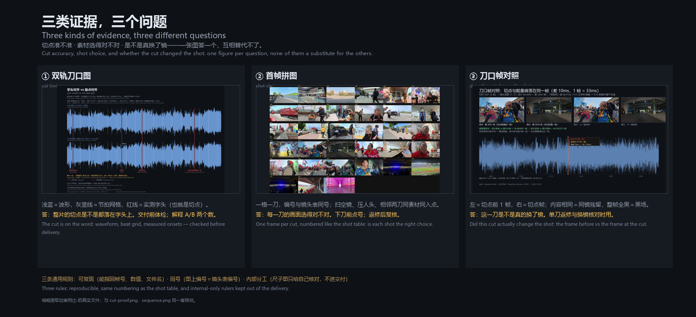

# 证据图例 · 三种图各答一个问题



> 一句话：**成片只能证明「能出片」，图才能证明「切得准、选得对」。**
> 但这三种图不能互相替代——它们回答的是三个不同的问题。

## 三种图的分工

| 图 | 回答 | 什么时候出 | 怎么看 |
|---|---|---|---|
| **① 双轨刀口图** | 整片的切点是不是都落在字头上 | 交付前体检；解释 A/B 指标 | 浅蓝＝波形、灰竖线＝节拍网格、红色竖线＝切点（切点按实测字头落刀，两者相差就是 A 口径的中位 +35ms）。理想状态：红线与实测字头差 1–2 帧。**整片若有一条固定偏差，先别怪切点，是基准错了**——回去解偏移 |
| **② 首帧拼图** | 每一刀选的画面对不对 | 下刀前点号；返修后复核 | 一格一刀，左上角编号。扫三样：空镜 / 镜头前压着人头 / 相邻两刀同素材同入点（看着像定格）。再扫三样：糊、竖屏、画面里带烧录字幕 |
| **③ 刀口帧对照** | 这一刀是不是真的换了镜 | 单刀返修；换镜核对 | 左＝切点前 1 帧，右＝切点帧。内容相同＝同镜残留；整帧全黑＝黑场。**亮度均值相近不等于同镜**（不同场景可以同均值，本技能踩过 6 次假阳性） |

## 为什么不能只出一张

- **双轨图**看的是**时间**：刀口在时间轴上准不准。它看不见画面。
- **首帧拼图**看的是**内容**：画面里有什么。它看不见时间精度。
- **刀口帧对照**看的是**单刀**：这一刀切下去有没有换镜。它看不出整片趋势。

缺任何一张，就会出现「数字全对但画面是空镜」「画面都对但每刀早 0.2 秒」这类交付。

## 三条通用规则

1. **可复现**：所有证据都要能指回帧号、数值、文件名，不用形容词。
2. **编号**：图注只写 `#01` 这样的编号，不带秒数——秒数留在镜头表里。
3. **同号**：图上的编号必须与镜头表同号。曾经图注 `#00` 起、表号 `#1` 起，差 1 导致用户报 6 刀、改错 4 刀，白出一版。
4. **内部分工**：包络尺子图只给自己核对，**不进交付**。交付＝成片 + 首帧图 + 镜头表 + 自检报告 + `改动台.html`。

## 生成方式

**四份刀口图用同一套版式**（v2 那版是手切的，证据图用改动台界面实拍，不走这套）：1600×900（中英双语那张 1600×1040）、深色 `#0E1116`、两轨波形（上＝网格、下＝字头/切点）、两行页脚。文件名一律 `cut-proof.png`。

| 图 | 脚本 / 来源 |
|---|---|
| 双轨刀口图（四份通用） | 数据走 `scripts/onset_beat_probe.py` / `check_cut.py fit_grid`；绘图脚本 `render_cutproof.py`（PIL，见下） |
| 首帧拼图 | `scripts/check_cut.py` 直接出（6 列，`#01` 起，与镜头表同号） |
| 刀口帧对照 | 按帧号 `select='eq(n,N)'` 抽帧后拼接（**不能用 `-ss`**，会落到相邻帧，PSNR 只有 9.2dB） |
| 包络尺子图 | `scripts/cut_ruler.py`，**仅内部用** |

### 双轨图的三条绘制约定

1. **上轨只放网格**：竖线等间隔，标签写「① 节拍网格（BPM，等间隔）」。
2. **下轨只放参照点**：红实线＝人耳验收的切点或实测字头；橙虚线＝字幕起点（只用于缩窗，不是切点）。
3. **只标一个数值**：最有说服力的那一处，用箭头 + 白框写「+250ms」，让观众一眼看懂差在哪；不要每刀都标，标满就看不见了。

### 绘图脚本

`render_cutproof.py`（PIL 手绘，不依赖 matplotlib）：读 `check_cut.py` 的 `load_audio` / `bandpass` / `rms_env` / `fit_grid`，保证波形和网格口径与体检脚本同源。

图例本身由 `showcase/_tools/render_legend.py` 生成（PIL，1600×730，三列并排，缩略图取案例② 的真实文件）：

```bash
python showcase/_tools/render_legend.py showcase showcase/证据图例.png
```
